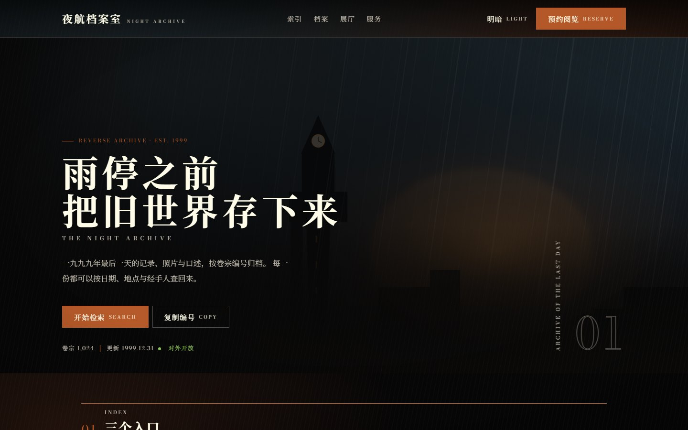

# reverse1999-ui

[English](README.md) · 简体中文

一个让 AI 写出「重返未来：1999 风格」界面的技能包：深底照片质感、米纸面板、一根锈红细线只做线和小编号、全部直角而形状靠切角与角花、宋体正文配 Didone 大写英文、编号与日期都是真数据、动效只有淡入与短位移。覆盖网页、手机网页、H5、小程序、Flutter、iOS 与 Android。

包里没有任何游戏素材，也不使用官方字体；所有内容都是代码、量出来的数值，以及我们自己画的图。



## 安装

仓库按 Agent Skills 的目录约定组织：`SKILL.md` 在根目录，不假定你用的是哪一家 agent。

**通用：skills CLI**，一条命令装给本机已有的 agent（Claude Code、Codex、Cursor、Gemini CLI、GitHub Copilot 等）：

```sh
npx skills add vemiy/reverse1999-ui-skill
npx skills add vemiy/reverse1999-ui-skill -g -y   # 全局安装并跳过确认
npx skills add vemiy/reverse1999-ui-skill -a codex   # 只装给某一个 agent
```

**DeepSeek Harness**

```sh
git clone https://github.com/vemiy/reverse1999-ui-skill ~/.dsh/skills/reverse1999-ui
# 或放进某个项目：<项目>/.dsh/skills/reverse1999-ui/
```

**Claude Code**

```sh
git clone https://github.com/vemiy/reverse1999-ui-skill ~/.claude/skills/reverse1999-ui
# 或放进某个项目：<项目>/.claude/skills/reverse1999-ui/
```

**OpenAI Codex**（命令行、IDE 扩展、桌面端）

```sh
git clone https://github.com/vemiy/reverse1999-ui-skill ~/.agents/skills/reverse1999-ui
# 或放进某个项目：<项目>/.agents/skills/reverse1999-ui/
```

Codex 需要重启一次才会识别。之后直接用「做成 1999 风格」这类说法即可，也可以用 `$reverse1999-ui` 指定。Codex 界面里显示的名字、简介与颜色写在 `agents/openai.yaml`。

**不能加载 skill 的 agent**（只认 `AGENTS.md`、`.cursorrules` 这类规则文件）：把仓库拷进项目内，然后在规则文件里指向 `SKILL.md`。

```md
做界面时，先读 vendor/reverse1999-ui/SKILL.md，按里面的步骤和规则做；需要的文件都在同一目录。
```

**ChatGPT 的网页版与桌面版**没有本地目录，直接把 SKILL.md 与要用的模板当附件上传即可。

## 结构

不进上下文的东西不会加载；触发后也只先读 `SKILL.md`，其余文件在任务需要时才逐个打开。

```text
reverse1999-ui-skill/
├── SKILL.md                  入口：气质、选页面类型、定变体、选平台、部件速查、规则、交付清单、文件地图
├── agents/openai.yaml        Codex 界面里的名字、简介、颜色（其他 agent 忽略）
├── assets/                   可直接拷进项目的东西
│   ├── tokens.json           平台无关变量：颜色、字体、字号、间距、线宽、动效、稀有度、四组预设
│   ├── reverse1999.css            网页套件：全部变量与部件，类名以 r99- 开头，不依赖框架
│   ├── fx.js                 主题记忆、滚动入场、页签、对话框、提示、指示条
│   ├── variant.js            按 ?variant= 或 data-variant 应用四组预设
│   └── art/                  示例用抽象插画（雨幕、拱门、电波、罗盘）
├── templates/                可运行的参考实现
│   ├── showcase.html         页面类型一：封面
│   ├── reading.html          页面类型二：卷宗（文章头、页签、目录、脚注、上下篇）
│   ├── library.html          页面类型三：档案库·列表（检索、筛选、卡网格、分页）
│   ├── console.html          页面类型三：陈列板（档案箱拼贴、证件牌、纸质档案、数据卡、徽章）
│   ├── mail.html             邮件（列表、未读方标、阅读区、附件条）
│   ├── shop.html             商城（货币条、商品格、购买面板）
│   ├── loading.html          加载界面（门形徽记、进度线、档案引文）
│   ├── app.html              手机网页（H5 / PWA）
│   ├── motion.html           动效样张，每格可重放，?play=1 自动演示
│   ├── specimen.html         全部网页部件与游戏内部件的样张
│   ├── antipatterns.html     做与不做的对照页
│   └── flutter/              Flutter 套件与示例界面（analyze / test / build web 全过）
├── docs/                     工作流：取数值、落代码、截图验收、提交
├── tools/                    预览服务、截图、页面探针、资源导出
├── scripts/                  CSS 校验（CI 与本地共用）
├── .github/workflows/        CI：CSS 校验与 Flutter 构建
├── references/               按需读的细节
│   ├── research.md           调研：官网、wiki、界面实测，借什么不借什么
│   ├── tokens.md             色值与对比度、字体字号、圆角、稀有度、质感层、平台映射
│   ├── components.md         每个部件的写法、含义与禁忌
│   ├── patterns.md           四种页面类型与手机端范式
│   ├── motion.md             动效原则、曲线、编排、清单
│   ├── variation.md          固定规则、六个维度、四组预设、新部件怎么推
│   ├── rules.md              做与不做，每条的理由
│   ├── glossary.md           内部叫法，以及对人怎么说
│   └── platforms/            web / mobile-web / flutter / ios / android / miniprogram / cross-platform
└── examples/                 截图，不用跑就能看
    ├── web/                  模板、浅色版、四组预设、样张、反例
    ├── app/                  手机各屏
    └── flutter/              Flutter 示例界面
```

## 预览

模板是纯静态文件，起一个静态服务器即可：

```sh
cd reverse1999-ui-skill
python -m http.server 8080
```

然后打开 `templates/showcase.html`。动效样张在 `templates/motion.html`；任意模板加 `?variant=nightrain|salon|dossier` 可切换到预设。

Flutter 套件：

```sh
cd templates/flutter
flutter pub get
flutter run -d chrome
```

## 来源与许可

- 本项目是非官方的界面风格研究，与《重返未来：1999》的权利方没有隶属、赞助、授权或合作关系；名称仅用于指代参考对象，商标归其所有者。
- 仓库不包含任何游戏素材：没有贴图、立绘、截图、音频或官方字体。`examples/` 里的图由本项目模板渲染，插画为自绘 SVG。
- 尺寸、色值、切边与字级来自对界面本身的测量，只用于实现风格一致的界面。具体数值见 `references/tokens.md` 与 `references/research.md`。
- 字体为 Noto Serif SC 与 Bodoni Moda，均为 SIL OFL。Flutter 套件打包前者 458 字子集；网页模板从 Google Fonts 取字，生产环境请自托管。
- 示例里的档案馆、编号与全部数字均为虚构。
- 代码、模板、变量与规则以 MIT 发布。若权利方认为内容需要调整，请开 issue，会立即处理。
